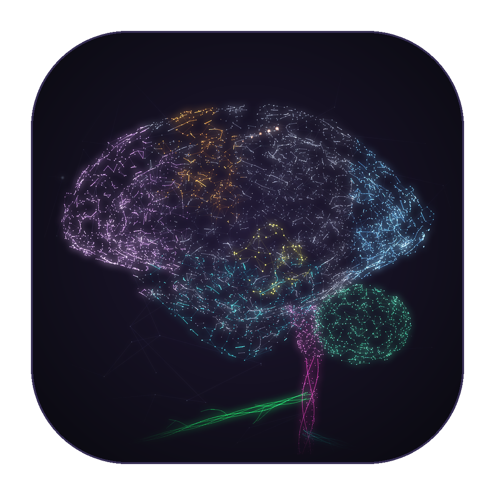

<h1 align="center">NEURAL OS</h1>

<b>Das Langzeitgedächtnis deiner KI.</b> Deine Notizen als 3D-Gehirn, und du siehst live, was Claude Code damit macht.

<a href="../../releases/latest"><b>⬇ Kostenlos herunterladen (Windows / macOS)</b></a>

---

## Was ist das?

NEURAL OS ist eine kostenlose Desktop-App für Windows und macOS:

- **Dein Wissen als Gehirn:** Obsidian-Vault, Ordner, PDFs und Bilder erscheinen als Punkte und Verbindungen. Deine Dateien werden nur gelesen, nie verändert.
- **Claude live zusehen:** Wenn Claude Code arbeitet, leuchten die Dateien auf, die Claude liest oder ändert. Jede Änderung lässt sich vorher/nachher vergleichen.
- **Claude erinnert sich:** Claude schlägt selbst in deinen Notizen und den letzten Sitzungen nach und nennt, was es benutzt hat.
- **Für Roblox-Entwickler:** Claude kennt die Hausregeln deines Spiels (Remotes, Module, DataStores) und sieht, wer was benutzt, bevor es Code ändert.
- **Privat:** Alles bleibt auf deinem Computer. NEURAL OS hat keine eigene KI und schickt nichts ins Internet.

## Installieren

1. Unter **[Releases](../../releases/latest)** die Datei für dein System laden:
   - Windows: `NEURAL-OS-Setup-….exe`
   - macOS: `NEURAL-OS-….dmg`
2. **Windows:** Falls „Der Computer wurde durch Windows geschützt“ erscheint → „Weitere Informationen“ → „Trotzdem ausführen“ (die App ist noch nicht signiert).
   **macOS:** App in „Programme“ ziehen, beim ersten Mal **Rechtsklick → Öffnen**.
3. NEURAL OS öffnen. Das **Tutorial** startet von selbst: du wählst, was du willst, und es verknüpft deine Notizen, verbindet Claude Code und sucht passende Connectoren, jeweils mit einem Klick.

**Für die Claude-Funktionen brauchst du:** [Claude Code](https://claude.com/claude-code) (Kommandozeile oder Claude-Desktop-App) und [Node.js LTS](https://nodejs.org).

## Wie Claude NEURAL OS lernt

Du musst Claude nichts erklären. Beim Einrichten von „Kontext für Claude“ bekommt Claude Code automatisch eine eingebaute Anleitung: was NEURAL OS ist und welches Werkzeug es wann benutzt (letzte Sitzungen, Notizen-Suche, Lernbuch, Roblox-Spielwissen).

## Fragen und Fehler

Fehler oder Ideen bitte als [Issue](../../issues) melden.

---

NEURAL OS ist ein unabhängiges Projekt und kein offizielles Produkt von Anthropic oder Roblox. „Claude“ und „Claude Code“ sind Marken von Anthropic, „Roblox“ ist eine Marke der Roblox Corporation.

---

## English

**NEURAL OS — your AI's long-term memory.** A free desktop app (Windows, macOS) that shows your notes as a 3D brain and lights up live what Claude Code reads and changes. Claude looks up your notes and past sessions by itself, and Roblox developers get game knowledge (remotes, modules, DataStores) for Claude. Everything stays on your computer.

**Install:** download from [Releases](../../releases/latest), open it, and follow the built-in setup guide. Unsigned for now: on Windows choose "More info → Run anyway", on macOS right-click → Open. Claude features need [Claude Code](https://claude.com/claude-code) and [Node.js LTS](https://nodejs.org).
