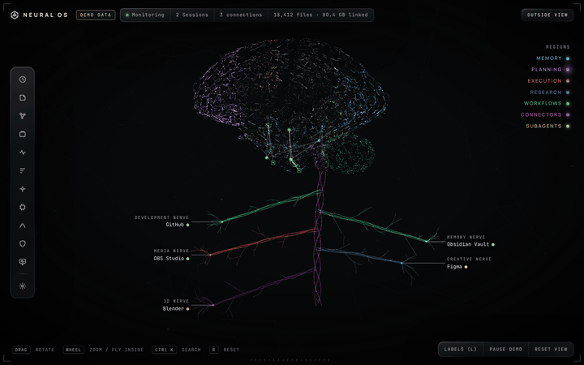

<p align="center"></p>

<h1 align="center">NEURAL OS</h1>
<p align="center"><b>Das Langzeitgedächtnis deiner KI.</b><br>Deine Notizen als 3D-Gehirn, und du siehst live, was Claude Code damit macht.</p>
<p align="center"><a href="../../releases/latest"><b>⬇ Kostenlos herunterladen (Windows / macOS)</b></a> · Open Source (MIT) · <a href="#english">English</a></p>

<p align="center"><br><sub>Mit Demodaten (oben links als „Demo data“ gekennzeichnet).</sub></p>

---

## Was ist das?

NEURAL OS ist eine kostenlose, quelloffene Desktop-App für Windows und macOS.

- **Dein Wissen als Gehirn:** Obsidian-Vault, Ordner, PDFs, Word-Dateien und Bilder erscheinen als Punkte und Verbindungen. Es gibt Suche, Tags, Tagesnotizen, Vorlagen, Canvas und Bases.
- **Notizen schreiben:** Mit dem eingebauten Editor bearbeitest du Markdown-Notizen. Jede Speicherung legt eine Version an, die du wiederherstellen kannst. Verknüpfte Ordner sind zuerst **nur lesbar**. Bearbeiten schaltest du pro Ordner selbst frei.
- **Claude live zusehen:** Wenn Claude Code arbeitet, leuchten die Dateien auf, die Claude liest oder ändert. Jede Änderung lässt sich vorher/nachher vergleichen.
- **Claude erinnert sich:** Claude schlägt selbst in deinen Notizen und den letzten Sitzungen nach und nennt dabei die Quellen.
- **Mehrere Geräte:** Das gleiche Gehirn auf PC und Mac, über deinen eigenen Cloud-Ordner (Google Drive, OneDrive, iCloud, Dropbox, MEGA).
- **Für Roblox-Entwickler:** Claude kennt die Hausregeln deines Spiels (Remotes, Module, DataStores) und sieht, wer was benutzt, bevor es Code ändert.

## Was NEURAL OS liest und was nie

Das kannst du im Code nachprüfen:

| Versprechen | Wo im Code |
|---|---|
| Keine Verbindung ins Internet. Der einzige Netzwerkweg ist `127.0.0.1` auf deinem Computer (Claude Code → NEURAL OS). Es gibt keine Telemetrie und keine Updates von außen. | [`src/main/monitor/receiver.ts`](src/main/monitor/receiver.ts), [`forwarder.ts`](src/main/monitor/forwarder.ts) |
| Von Claude Code kommen nur Metadaten: Werkzeug, Dateipfad, Zeit, Status. Deine Prompts, Claudes Antworten und Werkzeug-Ausgaben werden **nicht** gespeichert. Einzige Ausnahme sind die kurzen Zeilen `SESSION-NOTE:` und `LESSON:`, die Claude extra für dein Lernbuch schreibt. | [`src/main/monitor/forwarder.ts`](src/main/monitor/forwarder.ts), [`normalize.ts`](src/main/monitor/normalize.ts) |
| **Schlüssel und Passwörter kommen nie hinein.** Dateien wie `.env`, `*_key.txt`, `*.pem`, `credentials.json` oder `Passwörter.txt` werden gar nicht eingelesen. Text, der wie ein API-Schlüssel aussieht, wird in Vorschau, Suche und allem, was Claude bekommt, verdeckt. | [`src/main/library/secrets.ts`](src/main/library/secrets.ts) |
| Änderungen an Claude-Code-Dateien (`~/.claude/settings.json`, `~/.claude/CLAUDE.md`) gibt es nur nach deiner Zustimmung. Vorher siehst du den genauen Unterschied, eine Sicherung wird angelegt, und alles lässt sich mit einem Klick entfernen. | [`src/main/monitor/installer.ts`](src/main/monitor/installer.ts), [`readiness.ts`](src/main/monitor/readiness.ts) |
| Der Kontext-Server für Claude öffnet die Datenbank nur lesend. | [`src/mcp/server.ts`](src/mcp/server.ts) |
| Beim Geräte-Sync lädt NEURAL OS selbst nichts hoch. Es schreibt Dateien in einen Ordner, den du wählst. Den Rest macht dein Cloud-Programm. | [`src/main/sync/sync.ts`](src/main/sync/sync.ts) |

Tipp: Verknüpfe nur Ordner, die Claude sehen darf. Einzelne Unterordner oder Dateitypen kannst du pro Ordner ausschließen.

## Installieren

1. Unter **[Releases](../../releases/latest)** die Datei für dein System laden:
   - Windows: `NEURAL-OS-Setup-….exe`
   - macOS: `NEURAL-OS-….dmg`
2. Optional, aber empfohlen: Vergleiche die SHA-256-Prüfsumme aus den Release-Notizen (Windows: `Get-FileHash .\NEURAL-OS-Setup-….exe`, macOS: `shasum -a 256 NEURAL-OS-….dmg`).
3. **Windows:** Die App ist noch nicht signiert (eine Signatur kostet Geld). Falls „Der Computer wurde durch Windows geschützt“ erscheint: „Weitere Informationen“ → „Trotzdem ausführen“.
   **macOS:** App in „Programme“ ziehen, beim ersten Mal **Rechtsklick → Öffnen**.
4. NEURAL OS öffnen. Das **Tutorial** startet von selbst. Du wählst, was du willst, und es verknüpft deine Notizen, verbindet Claude Code und sucht passende Connectoren, jeweils mit einem Klick.

Die Installer baut GitHub selbst aus genau diesem Code (Tab „Actions“), mit Herkunftsnachweis. Prüfen geht mit `gh attestation verify <Datei> --repo lucqwer91-bot/neural-os-download`. Wer keiner fertigen Datei vertrauen will, baut die App selbst (siehe unten).

**Für die Claude-Funktionen brauchst du:** [Claude Code](https://claude.com/claude-code) (Kommandozeile oder Claude-Desktop-App) und [Node.js LTS](https://nodejs.org).

## Selbst bauen

Du brauchst Node.js 22 oder neuer.

```
npm install      # lädt auch das Electron-Programm (~100 MB)
npm test         # Unit-Tests
npm run build    # Build nach out/
npm start        # starten
npm run dist:win # Windows-Installer nach dist/ (auf Windows)
npm run dist:mac # macOS-.dmg nach dist/ (auf einem Mac)
```

## Wie Claude NEURAL OS lernt

Du musst Claude nichts erklären. Beim Einrichten von „Kontext für Claude“ bekommt Claude Code automatisch eine eingebaute Anleitung: was NEURAL OS ist und welches Werkzeug es wann benutzt (letzte Sitzungen, Notizen-Suche, Lernbuch, Roblox-Spielwissen).

## Aufbau

| Pfad | Inhalt |
|---|---|
| `src/main/library/` | Bibliothek: Import, verknüpfte Ordner, Suche, Editor, Links |
| `src/main/monitor/` | Claude-Code-Monitor: Empfänger, Hooks, Änderungsprotokoll, Lernbuch |
| `src/main/sync/` | Geräte-Sync über deinen Cloud-Ordner |
| `src/mcp/` | Kontext-Server für Claude (MCP, nur lesend) |
| `src/renderer/` | Oberfläche: 3D-Gehirn, Module |
| `docs/` | Spezifikation und Anleitung |

## Fragen und Fehler

Fehler oder Ideen bitte als [Issue](../../issues) melden. Pull Requests sind willkommen. Sicherheitsprobleme bitte privat melden, siehe [SECURITY.md](SECURITY.md). [Code signing policy](CODE_SIGNING_POLICY.md).

---

<a id="english"></a>
## English

NEURAL OS is a free, open-source (MIT) desktop app for Windows and macOS. It shows your notes (Obsidian vault, folders, PDFs, Word files, images) as a 3D brain, lets you edit notes with version history, and shows live which files Claude Code reads and changes, with before/after diffs. Claude can look up your notes and past sessions through a read-only local MCP server. The same brain can be shared across devices through your own cloud folder.

**Privacy, checkable in the code:** no internet connection (only `127.0.0.1`), no telemetry. From Claude Code only metadata is stored, never prompts or outputs (except the short `SESSION-NOTE:`/`LESSON:` lines Claude writes for the lesson book). Key and password files are never indexed, and key-like text is masked everywhere ([`secrets.ts`](src/main/library/secrets.ts)). Changes to Claude Code's files happen only after you consent, with a diff, a backup and one-click undo.

Download from [Releases](../../releases/latest) (unsigned for now; compare the SHA-256 in the release notes) or build it yourself with `npm install && npm run build && npm start`.

---

<sub>MIT License. NEURAL OS is an independent project and not an official product of Anthropic, Obsidian or Roblox. "Claude" and "Claude Code" are trademarks of Anthropic, "Roblox" is a trademark of Roblox Corporation.</sub>
