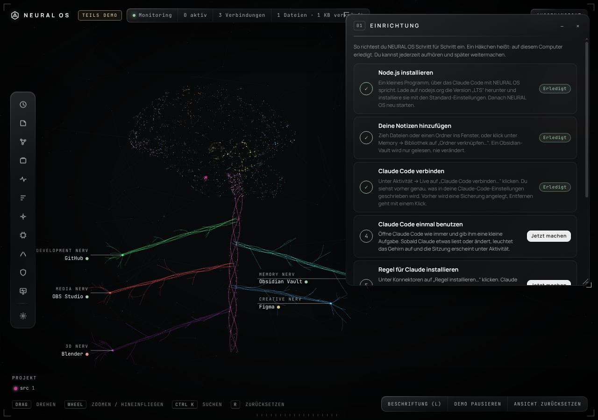
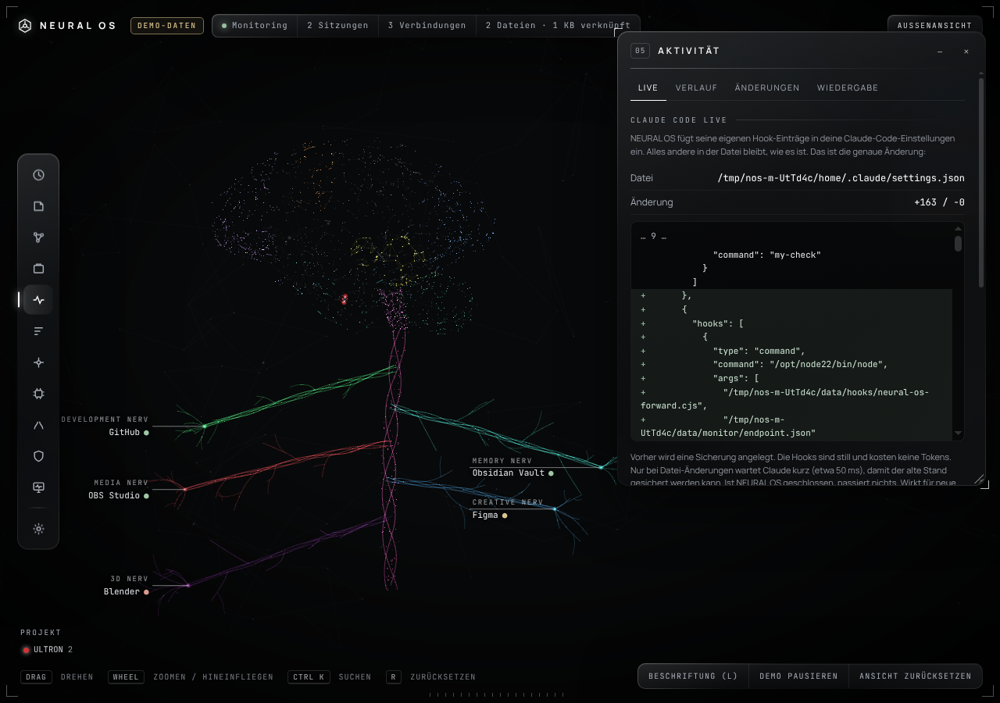
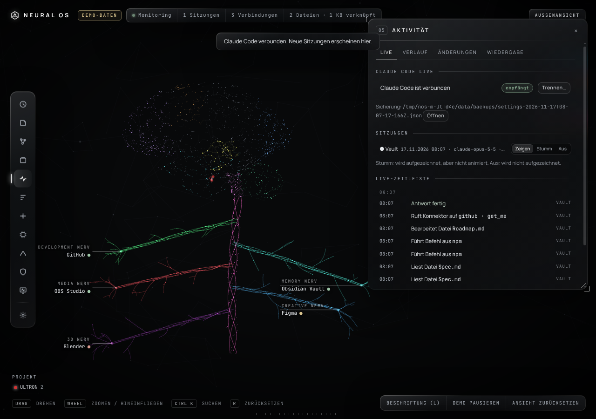
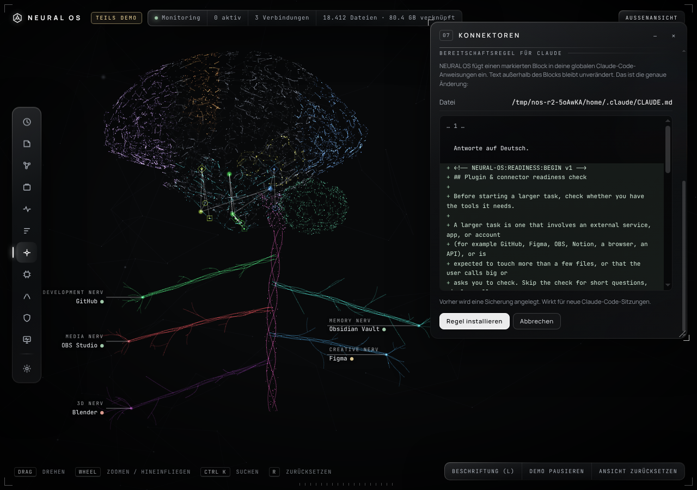
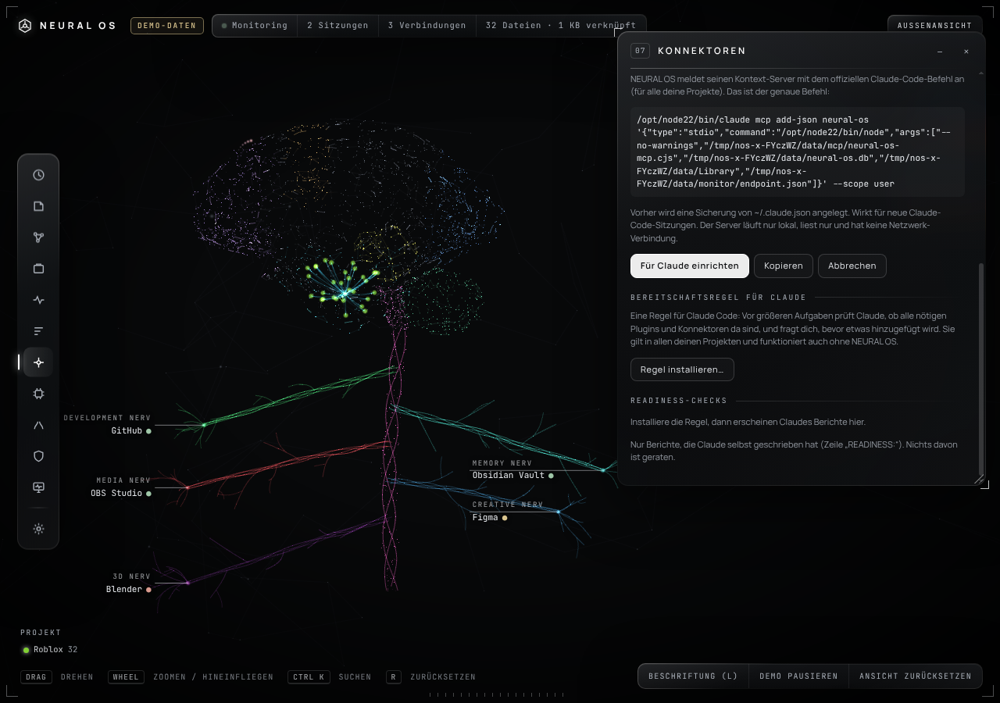
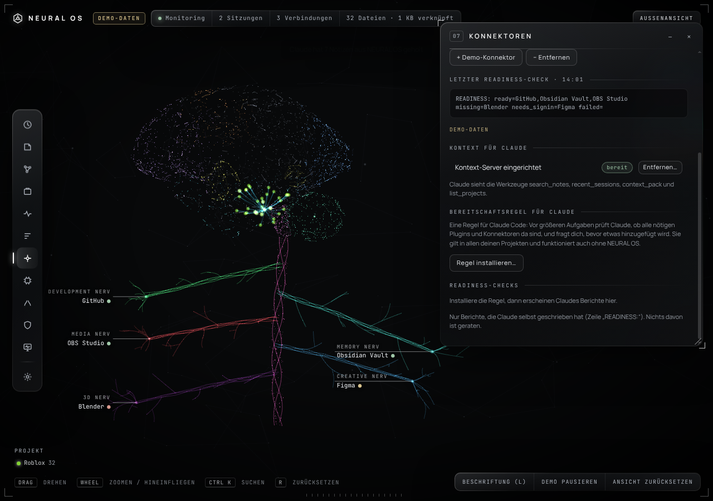

# NEURAL OS einrichten – Schritt für Schritt

Diese Anleitung ist für Leute, die noch nie etwas „eingerichtet“ haben. Du brauchst
etwa 15 Minuten. Du kannst jederzeit aufhören und später weitermachen.

**Was du am Ende hast:** Ein 3D-Gehirn mit deinen Notizen. Es leuchtet live auf, wenn
Claude Code arbeitet. NEURAL OS merkt sich jede Sitzung, und Claude kann später selbst
nachschlagen, was ihr beim letzten Mal gemacht habt.

**Was NEURAL OS nie tut:** Es verändert deine Notizen nicht, schickt nichts ins
Internet und speichert nicht, was du Claude schreibst.

> Tipp: In der App findest du dieselben Schritte mit Häkchen unter
> **Einstellungen (Zahnrad unten links) → Einrichtung → Öffnen**. Dort siehst du immer,
> was schon erledigt ist.

---

## Schritt 0: NEURAL OS installieren

**Windows**
1. Lade die Datei `NEURAL-OS-Setup-….exe` herunter und doppelklicke sie.
2. Erscheint „Der Computer wurde durch Windows geschützt“: klick auf **Weitere
   Informationen**, dann auf **Trotzdem ausführen**. (Das kommt, weil die App noch
   kein teures Zertifikat hat. Es ist nur beim ersten Mal.)
3. Klick dich mit **Weiter** durch. Du brauchst keine Admin-Rechte.

**Mac**
1. Lade die Datei `NEURAL-OS-…-mac.dmg` herunter und doppelklicke sie.
2. Zieh das NEURAL-OS-Symbol in den Ordner **Programme**.
3. Beim ersten Öffnen sagt der Mac, die App sei nicht überprüft. Dann:
   **Systemeinstellungen → Datenschutz & Sicherheit**, ganz nach unten scrollen,
   **Trotzdem öffnen** klicken. (Auf älteren Macs: Rechtsklick auf die App →
   **Öffnen** → **Öffnen**.)

## Schritt 1: Node.js installieren

Node.js ist ein kleines Programm, über das Claude Code mit NEURAL OS spricht.

1. Geh auf **nodejs.org**.
2. Lade die Version mit **LTS** herunter (der linke, grüne Knopf).
3. Installiere sie. Immer **Weiter** klicken, nichts ändern.
4. NEURAL OS einmal schließen und wieder öffnen.

Hast du Claude Code schon im Terminal installiert, ist Node.js meist schon da. Die App
zeigt dir unter **Einrichtung**, ob es gefunden wurde.

## Schritt 2: Deine Notizen hinzufügen

Beim ersten Start fragt NEURAL OS, welche Notizen du hast.

- **Du hast einen Obsidian-Vault:** wähle „Obsidian-Vault verknüpfen“ und such den
  Ordner aus. NEURAL OS liest ihn nur, es ändert nie etwas daran.
- **Du hast lose Dateien:** zieh sie einfach ins Fenster.

Später geht das unter **Memory → Bibliothek → Ordner verknüpfen…**. Danach erscheint
jede Notiz als Punkt im Gehirn.

## Schritt 3: Claude Code verbinden

1. Klick links auf **Aktivität** (das Symbol mit der Zickzack-Linie).
2. Klick auf **Claude Code verbinden…**.
3. Du siehst jetzt genau, was NEURAL OS in deine Claude-Code-Einstellungen schreibt.
   Grün ist neu. Klick unten auf **Claude Code verbinden**.

Vorher wird automatisch eine Sicherung angelegt. Rückgängig machen geht mit einem
Klick auf **Trennen…**. Du musst das nur einmal machen, nicht bei jedem Start.

## Schritt 4: Claude Code einmal benutzen

Öffne Claude Code wie immer und gib ihm eine kleine Aufgabe, zum Beispiel
„Lies die README und sag mir in zwei Sätzen, worum es geht“.

Sobald Claude etwas liest oder ändert, leuchtet das Gehirn auf. Unter **Aktivität →
Live** siehst du die Sitzung. Nach der Sitzung schreibt NEURAL OS eine
Sitzungsnotiz (unter **Memory**, Projekt „Claude Sessions“).

## Schritt 5: Die Regel für Claude installieren

1. Klick links auf **Konnektoren** (das Symbol mit dem Kreuz).
2. Bei „Bereitschaftsregel für Claude“ auf **Regel installieren…** klicken.
3. Du siehst den genauen Text, der in deine Claude-Anweisungen kommt. Klick unten auf
   **Regel installieren**.

Die Regel sorgt für zwei Dinge: Claude prüft vor großen Aufgaben, ob alle Werkzeuge
da sind. Und am Ende einer Aufgabe schreibt Claude eine kurze Zeile
(`SESSION-NOTE: …`), die in deine Sitzungsnotiz kommt. Das kostet nur ein paar Tokens.

## Schritt 6: Kontext für Claude einrichten

1. Bleib in **Konnektoren** und scroll zu **Kontext für Claude**.
2. Klick auf **Für Claude einrichten…**. Du siehst den genauen Befehl. Klick unten noch
   einmal auf **Für Claude einrichten**.
3. Starte Claude Code einmal neu.

Jetzt kann Claude selbst in deinen Notizen nachschlagen. Es liest nur und braucht kein
Internet.

## Schritt 7: Ausprobieren

Öffne eine neue Claude-Code-Sitzung im selben Projekt und frag:

> Was haben wir letztes Mal in diesem Projekt gemacht?

Claude holt sich die passenden Notizen. Im Gehirn leuchten genau diese Notizen auf, und
oben erscheint „Claude hat … Notizen aus NEURAL OS geholt“. **Fertig!**

---

## Wenn etwas nicht klappt

| Problem | Lösung |
|---|---|
| Das Gehirn leuchtet nicht, wenn Claude arbeitet | NEURAL OS muss offen sein. Unter **Aktivität → Live** steht „Empfängt“? Wenn dort **Neu verbinden…** steht, klick darauf. |
| „Node.js nicht gefunden“ | Schritt 1 machen, danach NEURAL OS neu starten. |
| Claude findet die NEURAL-OS-Werkzeuge nicht | Claude Code nach Schritt 6 neu starten. |
| „Der Befehl claude wurde nicht gefunden“ | Die App zeigt dir einen Befehl. Kopier ihn, öffne das Terminal (Mac) oder PowerShell (Windows), füge ihn ein und drück Enter. |
| Ich will alles wieder entfernen | **Aktivität → Trennen…**, und unter **Konnektoren** bei der Regel und beim Kontext jeweils **Entfernen…**. Jede Änderung hat eine Sicherung im Ordner „backups“ der App. |
